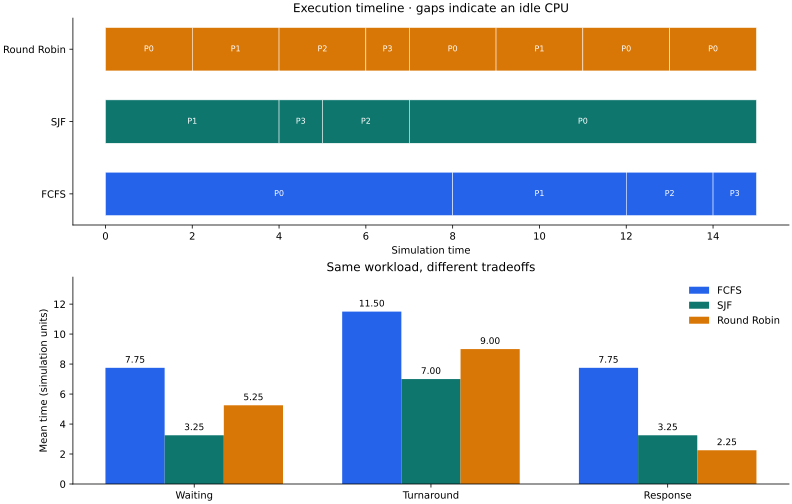

# CPU Scheduling Simulator

[](https://github.com/Nikkilodeonee/os-scheduling-simulator/actions/workflows/ci.yml)

[](LICENSE)

Compare **FCFS**, **non-preemptive SJF**, and **Round Robin** on the same workload.
Inspect execution timelines, measure scheduling tradeoffs, and export every result.

Started as Operating Systems coursework comparing FCFS and SJF. Extended into a
reproducible Python experiment tool with a tested algorithm library, Round Robin,
CSV input, a CLI, structured reports, and automated quality checks.



## Try it

Requires Python 3.10+. The core and tests use only the standard library.

```bash
git clone https://github.com/Nikkilodeonee/os-scheduling-simulator.git
cd os-scheduling-simulator
python main.py --input examples/convoy.csv --quantum 2
```

To generate charts and install the console command, use a virtual environment:

```bash
python -m venv .venv
# Linux/macOS: source .venv/bin/activate
# Windows PowerShell: .\.venv\Scripts\Activate.ps1
python -m pip install ".[plot]"
cpu-sim --input examples/convoy.csv --quantum 2 --plot
```

Charts are saved to disk; no desktop display is required.

## A result you can explain

The checked-in [convoy workload](examples/convoy.csv) has four processes.
P0 arrives with a long burst, P1 arrives at the same time, and two shorter jobs
arrive later. All algorithms receive exactly these inputs.

| Algorithm | Mean waiting time | Mean turnaround | Mean response |
| --- | ---: | ---: | ---: |
| FCFS | 7.75 | 11.50 | 7.75 |
| SJF | 3.25 | 7.00 | 3.25 |
| Round Robin (quantum 2) | 5.25 | 9.00 | 2.25 |

SJF cuts mean waiting time on this example. Round Robin starts each job sooner
on average, trading that responsiveness against additional waiting after preemption.
These are simulation time units, not wall-clock benchmark measurements.

[Raw process metrics](examples/convoy/processes.csv) ·
[Timeline](examples/convoy/timeline.csv) ·
[Summary and parameters](examples/convoy/summary.json)

## Run your own experiment

```bash
python main.py --count 25 --seed 42 --quantum 2 --plot --output-dir results/random
python main.py --count 100 --arrival-max 200 --burst-max 20 --seed 123
python main.py --help
```

Or supply a CSV with this exact header and non-negative integer IDs/arrival times,
positive integer bursts, and unique process IDs:

```csv
pid,arrival_time,burst_time
0,0,8
1,0,4
2,1,2
3,2,1
```

Every run writes:

| File | Contents |
| --- | --- |
| `workload.csv` | Exact input, including generated processes |
| `processes.csv` | Per-process waiting, turnaround, response, start and completion |
| `timeline.csv` | Each CPU slice, with algorithm, PID, start and end |
| `summary.json` | Schema version, parameters, averages, utilization and throughput |
| `comparison.svg` | Timeline and metric chart, when `--plot` is supplied |

Replay a generated experiment with
`python main.py --input results/random/workload.csv --quantum 2`.
The original 25-process seed-42 experiment is also preserved in
[examples/seed-42](examples/seed-42): FCFS mean wait **41.52**, SJF **24.28**,
Round Robin **50.24** (quantum 2).

## Engineering choices

- **Immutable inputs and results:** comparing algorithms cannot overwrite a
  previous result or mutate the shared workload.
- **Event-driven simulation:** idle periods jump to the next arrival. SJF selects
  ready jobs with a min-heap instead of sorting the queue at each decision.
- **Explicit tie rules:** FCFS uses arrival then PID; SJF uses burst, arrival, then
  PID. Round Robin admits boundary arrivals before requeueing the preempted job.
- **Reproducibility:** each generator owns a local random-number generator.
  CSV/JSON reports retain full precision; rounding is only for display.
- **Separation of concerns:** `core.py` contains the algorithms; `cli.py` handles
  input, exports and lazy-loaded plotting.

[Metric definitions, complexity, model assumptions and interview notes](docs/engineering.md)

## Test and develop

```bash
python -m unittest discover -s tests -v
python -m pip install ".[dev,plot]"
python -m ruff check .
python -m ruff format --check .
python -m build --no-isolation
```

The 19 tests cover hand-worked schedules, idle gaps, arrival boundaries,
non-preemption, deterministic ties, conservation of CPU time over 30 generated
workloads, invalid CSVs, and byte-identical report regeneration.
GitHub Actions runs tests, lint, formatting, a headless chart smoke test and package
builds on Python 3.10/3.12/3.14 on Linux, plus Python 3.12 on Windows.

## Scope

A single CPU, one known CPU burst per process, integer arrival times, and zero
context-switch overhead. There is no I/O blocking, multicore scheduling, burst
prediction, or real kernel integration. SJF uses information a real scheduler
would generally need to estimate; no policy is claimed to win on every workload.

## License

[MIT](LICENSE) · [Roman Sushkin](https://github.com/Nikkilodeonee)
